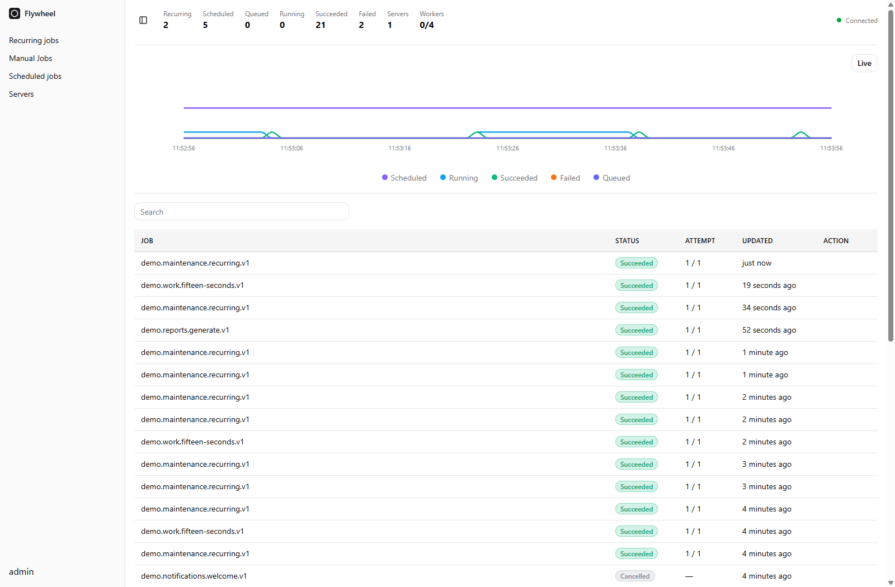
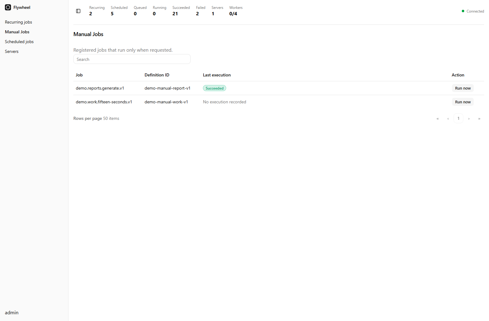
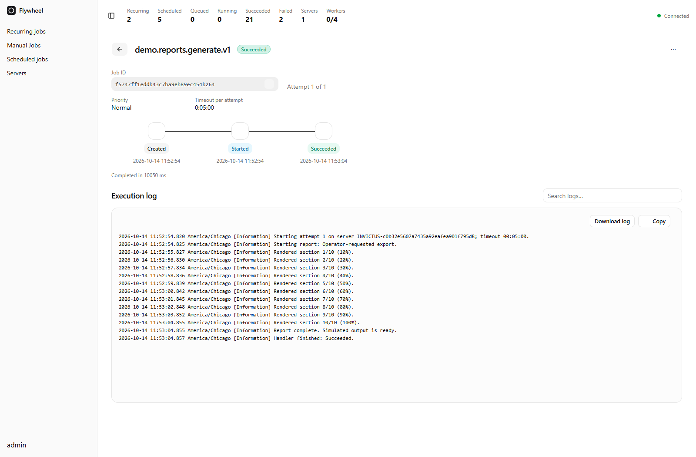

# Flywheel

**Background work. Everything in view.**

Queue, schedule, retry, and chain background jobs in .NET. Flywheel pairs a typed C# job API with your choice of storage and an optional live Blazor dashboard, so you can keep work moving and see what happens along the way.

Use it for report generation, data imports, scheduled maintenance, notifications, and workflows with multiple steps. Start locally with in-memory storage, persist work to disk, or coordinate workers across application instances with Redis or PostgreSQL.

[**Explore Flywheel →**](https://flywheel.soenneker.com) · [Get started](#get-started) · [Try the dashboard](#try-the-dashboard) · [Documentation](#keep-building)

[](https://www.nuget.org/packages/Soenneker.Flywheel.Core/)
[](https://github.com/soenneker/soenneker.flywheel.suite/actions/workflows/build-and-test.yml)
[](https://www.nuget.org/packages/Soenneker.Flywheel.Core/)
[](LICENSE)

<a href="https://flywheel.soenneker.com">
  <picture>
    <source media="(prefers-color-scheme: dark)" srcset="docs/images/dashboard-dark.png" />
    
  </picture>
</a>

*The optional Flywheel dashboard, shown with illustrative demo data.*

## Why build with Flywheel?

- **Write the work in C#.** Define a job method, inject your services, and submit a typed payload. Generated job identifiers keep submission connected to your handler.
- **Run on your schedule.** Enqueue immediately, delay execution, choose a specific time, or set up interval and cron schedules with time-zone support.
- **Keep workflows moving.** Chain jobs so each step follows a successful execution. Configure retries, concurrency limits, and rate limits around the work you run.
- **See the execution story.** Follow live activity, search jobs, inspect attempts and progress, and read captured `ILogger` output in the dashboard.
- **Choose the storage that fits.** Use memory for a simple local start, filesystem storage for persistence in a single process, or Redis or PostgreSQL for shared work across instances.
- **Use AOT-friendly dispatch.** Generated invokers call job methods directly without runtime reflection. Full application AOT compatibility depends on the host, storage, and serialization configuration.

Flywheel targets **.NET 10** and is **MIT licensed**. The job runtime works independently of the dashboard; add the UI when you want an operational view of your workers.

## Put background work to work

| What you need | How Flywheel helps |
| --- | --- |
| **Reports, imports, and notifications** | Submit a job and let background workers execute it while your application continues serving requests. |
| **Nightly cleanup or weekday reports** | Register an interval or cron schedule, including the time zone your business uses. |
| **Workflows with dependent steps** | Chain jobs so later steps wait for earlier steps to succeed, including through retries. |
| **Controlled calls to external services** | Apply job concurrency and rate limits to manage how much work starts at once. |
| **Visibility when a job needs attention** | Find executions, inspect their attempts and logs, follow progress, and cancel work from the dashboard. |

### Configure job log capture

Flywheel captures handler `ILogger` messages at `Information` and above by default. To include Debug messages in job execution logs:

```csharp
builder.Services.AddFlywheel(options => options.MinimumJobLogLevel = LogLevel.Debug);
```

Use `Microsoft.Extensions.Logging.LogLevel`. The application's logging filters must also allow the desired level for Flywheel's `JobLogCapture` provider. For example, with the standard Microsoft logging pipeline:

```csharp
builder.Logging.AddFilter<Soenneker.Flywheel.Core.Logging.JobLogCapture>(null, LogLevel.Debug);
```

`MinimumJobLogLevel` accepts `Trace` through `Critical`; `None` disables handler log capture. It does not disable Flywheel's own execution lifecycle messages. This applies to future executions; previously filtered messages cannot be recovered.

## Get started

Run your first job with **.NET 10**, using in-memory storage so no external database is needed.

### 1. Create an app and install the packages

```shell
dotnet new web -n MyFlywheelApp
cd MyFlywheelApp

dotnet add package Soenneker.Flywheel.Core
dotnet add package Soenneker.Flywheel.Memory
dotnet add package Soenneker.Flywheel.Generators
```

In your `.csproj`, add `PrivateAssets="all"` to the existing `Soenneker.Flywheel.Generators` package reference, keeping its installed version.

### 2. Define and queue a job

Replace `Program.cs` with:

```csharp
using System.Text.Json.Serialization;
using Soenneker.Flywheel.Core.Attributes;
using Soenneker.Flywheel.Core.Registrars;
using Soenneker.Flywheel.Core.Services.Abstract;
using Soenneker.Flywheel.Generated;
using Soenneker.Flywheel.Memory;

var builder = WebApplication.CreateBuilder(args);

builder.Services.AddFlywheel(options => options.Workers = 4)
    .AddMemory()
    .AddGeneratedJobs();

var app = builder.Build();
var client = app.Services.GetRequiredService<IJobClient>();

await client.Enqueue(
    FlywheelJobs.MessageJobs_Write,
    new Message("Hello from Flywheel"));

await app.RunAsync();

public sealed record Message(
    [property: JsonPropertyName("text")] string Text);

public sealed class MessageJobs(ILogger<MessageJobs> logger)
{
    [FlywheelJob("message.write.v1")]
    public Task Write(Message message, CancellationToken cancellationToken)
    {
        logger.LogInformation("{Message}", message.Text);
        return Task.CompletedTask;
    }
}
```

### 3. Run it

```shell
dotnet run
```

Look for **Hello from Flywheel** in the console. Your application queues the message on startup, and a Flywheel worker runs the handler. Press **Ctrl+C** to stop it.

`Enqueue` returns after saving the job to your selected storage; execution happens in the background. In your own application, inject `IJobClient` into the service or endpoint that submits work, and inject application services into your job class.

**Memory storage is temporary:** jobs, schedules, and history are lost when the process stops. Choose filesystem, Redis, or PostgreSQL storage when work must survive restarts.

## One job, your schedule

Using the `client` and `MessageJobs` from the quick start, add these calls before `app.RunAsync()`, or use the same API from an injected `IJobClient`:

```csharp
// Give a job ten minutes before it becomes eligible to run.
await client.Enqueue(FlywheelJobs.MessageJobs_Write,
    new Message("Follow up later"),
    delay: TimeSpan.FromMinutes(10));

// Run once at a specific time.
await client.Schedule(FlywheelJobs.MessageJobs_Write,
    new Message("Tomorrow's reminder"),
    DateTimeOffset.UtcNow.AddDays(1));

// Register once; nothing is queued until explicitly requested.
await client.Manual("manual-message", FlywheelJobs.MessageJobs_Write,
    new Message("Requested by an operator"));

// Or choose Run now on the dashboard's Manual Jobs page.
string? executionId = await client.RunManual("manual-message");

// Repeat at a fixed interval.
await client.Recurring("hourly-message", FlywheelJobs.MessageJobs_Write,
    new Message("Hourly check-in"), TimeSpan.FromHours(1));

// Run at 9 a.m. every weekday in Chicago.
await client.Schedule("weekday-message", FlywheelJobs.MessageJobs_Write,
    new Message("Good morning"), "0 9 * * MON-FRI",
    timeZoneId: "America/Chicago");
```

Keep the host running so workers can process scheduled work. Reusing a manual, recurring, or cron ID leaves its existing definition unchanged. Manual jobs never run automatically and have their own **Manual Jobs** dashboard page.

Jobs can execute more than once, so make handlers safe to retry and pass the cancellation token to asynchronous work. See the [job execution guide](docs/core.md) and [client API](src/Soenneker.Flywheel.Core/Services/Abstract/IJobClient.cs) for chains, submission deduplication, progress reporting, and execution policies.

## Chain jobs

Using the quick-start job, submit an ordered workflow before `app.RunAsync()`:

```csharp
IReadOnlyList<string> jobIds = await client.Chain([
    FlywheelJobs.MessageJobs_Write.With(
        new Message("First step"), MessageJsonContext.Default.Message),
    FlywheelJobs.MessageJobs_Write.With(
        new Message("Second step"), MessageJsonContext.Default.Message,
        delay: TimeSpan.FromSeconds(10))
], idempotencyKey: "message-workflow-123");
```

Add `MessageJsonContext.cs` to provide the source-generated JSON metadata required by `With(...)`:

```csharp
using System.Text.Json.Serialization;

[JsonSourceGenerationOptions(System.Text.Json.JsonSerializerDefaults.Web)]
[JsonSerializable(typeof(Message))]
internal partial class MessageJsonContext : JsonSerializerContext;
```

- A chain atomically saves 1–100 steps and returns their job IDs in order. Submission completes when saved; workers execute the jobs afterward.
- Each step waits for predecessor success. Retries keep successors waiting; final failure or cancellation cancels the remaining steps. The default is one attempt. Pass `policy: new JobPolicy { MaxAttempts = 3 }` to `With(...)` to allow three attempts for that step (`JobPolicy` is in `Soenneker.Flywheel.Communication.Dtos`).
- A first-step delay starts at submission. Later delays start after predecessor success; here, the second step becomes eligible ten seconds later. Worker, concurrency, and rate limits still apply.
- Reuse a stable chain `idempotencyKey` when retrying an uncertain submission to get the original IDs while the deduplication record is retained. Use a new key for a new workflow. Individual step idempotency keys are unsupported.
- Steps can use different registered jobs and payload types; supply JSON metadata for each type. All payloads are supplied upfront; results are not automatically passed between steps.

All built-in storage providers support chains. Custom stores must implement `IJobChainStore`. Handlers must still be safe to retry.

## Manage saved definitions

Registration remains create-if-absent. Use explicit update calls to change future runs:

```csharp
await client.SetRecurringEnabled("hourly-message", false);
await client.UpdateRecurring("hourly-message", FlywheelJobs.MessageJobs_Write,
    new Message("Updated message"), TimeSpan.FromMinutes(30), enabled: false);
await client.SetRecurringEnabled("hourly-message", true);

await client.UpdateSchedule("weekday-message", FlywheelJobs.MessageJobs_Write,
    new Message("Updated reminder"), "0 10 * * MON-FRI", timeZoneId: "America/Chicago");
await client.DeleteRecurring("weekday-message");

await client.UpdateManual("manual-message", FlywheelJobs.MessageJobs_Write,
    new Message("Updated manual payload"));
await client.DeleteManual("manual-message");
```

Updates return false for missing or system-owned definitions. Recurring updates optionally accept `expectedRevision` to reject stale edits. Updates recalculate the next run; pass `enabled: false` to keep a definition paused. Resume schedules the next cron time or a full new interval without replaying missed runs. Pausing and deletion preserve existing executions and history; **Run now** remains available while a schedule is paused.

The recurring-job detail view provides **Edit definition**, **Pause schedule / Resume schedule**, and **Delete definition**. Manual rows provide **Manage definition**. Editors can change the JSON payload and execution policy; recurring editors also change the interval or cron expression and time zone. Deletion requires confirmation, and stale recurring edits are rejected.

## Conditional continuations

Attach work to an existing retained execution, including one that has already finished:

```csharp
using Soenneker.Flywheel.Communication.Enums;

string parentId = await client.Enqueue(FlywheelJobs.MessageJobs_Write, new Message("Prepare"));
string cleanupId = await client.ContinueWith(parentId, FlywheelJobs.MessageJobs_Write,
    new Message("Cleanup"), condition: ContinuationCondition.OnCompleted,
    idempotencyKey: "message-cleanup-123");
```

Choose `OnSuccess` (default), `OnFailure` (attempts exhausted), `OnCancelled`, or `OnCompleted` (any terminal outcome). Retries keep continuations waiting. A missing or expired predecessor is rejected. A condition that does not match skips that branch and its descendants; skipped work does not trigger failure/cancellation cleanup. Optional delays begin when dependencies are satisfied. Reuse a stable submission key for uncertain retries, and a new key for new work.

## Parallel batches

Submit independent steps atomically and optionally run a final step after all members finish. This example reuses the `MessageJsonContext` from the chaining example:

```csharp
var batch = await client.Batch([
    FlywheelJobs.MessageJobs_Write.With(new Message("Process A"), MessageJsonContext.Default.Message),
    FlywheelJobs.MessageJobs_Write.With(new Message("Process B"), MessageJsonContext.Default.Message)
], continuation: FlywheelJobs.MessageJobs_Write.With(
    new Message("Finalize"), MessageJsonContext.Default.Message),
    condition: ContinuationCondition.OnSuccess,
    idempotencyKey: "message-batch-123");
```

`batch.Id` identifies the workflow; `batch.JobIds` contains execution IDs in submission order, including `batch.ContinuationId` when a final step exists. Batch members may run in parallel, subject to worker capacity and method limits. The final step waits through retries and runs only when every member succeeds (`OnSuccess`) or every member finishes regardless of outcome (`OnCompleted`). Member failure does not cancel sibling jobs.

Batches accept 1–999 members. A workflow may contain up to 1,000 jobs after attaching continuations. Payloads are supplied upfront; results are not automatically passed between jobs. All built-in providers implement `IJobWorkflowStore`; custom stores must opt in. Upgrade every worker sharing storage before submitting workflows or using definition management.

Open any member's execution details to see the whole workflow, finished/total progress, dependency links, conditions, errors, and individual job logs. Skipped branches are labeled **Skipped**. The view refreshes every five seconds. Workflow executions stay retained until all members finish and the last member's history retention expires; disabling completed-job retention still preserves dependencies until the workflow finishes.

### Run work on demand

Register reusable work with `client.Manual(...)`, then open **Manual Jobs** and select **Run now**. Registration does not queue an execution. The page shows the latest execution status and links to its details.



### Keep concurrency under control

Declare limits on the job method when a workload needs them:

```csharp
[FlywheelJob("message.write.v1",
    MaxConcurrency = 1,
    RateLimit = 10,
    RateWindowSeconds = 60)]
```

Applied to the quick start's `Write` method, this allows one execution at a time and up to ten execution starts per minute. With Redis or PostgreSQL, workers sharing the same job storage coordinate these limits across instances.

### Worker pools

Split a server's worker budget between workloads:

```csharp
builder.Services.AddFlywheel(options =>
{
    options.Workers = 8;
    options.Pools["reports"] = 3;
    options.Pools["imports"] = 2;
})
    .AddMemory()
    .AddGeneratedJobs();
```

The remaining three workers belong to `default`. Route job methods with `[FlywheelJob("report.generate", Pools = new[] { "reports" })]`; methods without a pool list use `default`. The Servers page shows capacity and active work per pool.

### Queue controls

The **…** menu offers **Top of queue**, **Bottom of queue**, **Run now**, and cancellation where applicable. Queue moves affect the next attempt and still respect pool, concurrency, and rate limits.

```csharp
await client.UpdateQueue(executionId, JobQueueAction.MoveToTop);
```

`JobQueueAction` is in `Soenneker.Flywheel.Communication.Enums`. Use `MoveToBottom` to defer queued work or `RunNow` to release a delayed execution. Run now on a manual or recurring definition creates a fresh execution.

See [pool configuration and queue controls](docs/core.md#worker-pools) for the API details.

## Choose your storage

Choose one provider when registering Flywheel. Your job methods and submission API stay the same.

| Provider | Best fit | What to know |
| --- | --- | --- |
| [Memory](docs/memory.md) | Local development, tests, and temporary background work | No database to run. Each application process has independent data, which is lost on restart. |
| [Filesystem](docs/filesystem.md) | Local applications and modest workloads that need persistence | Stores jobs on disk without a database server. One process owns the database path at a time. |
| [Redis](docs/redis.md) | Shared queues and workers across application instances | Requires Redis. Configure persistence and a no-eviction policy when jobs must survive restarts without data loss. |
| [Postgres](docs/postgres.md) | Shared queues and workers using PostgreSQL | Uses Librarian documents and atomic PostgreSQL transactions. |

To switch the quick start to Redis, install `Soenneker.Flywheel.Redis`, replace the memory namespace with `using Soenneker.Flywheel.Redis;`, and replace its registration with:

```csharp
builder.Services.AddFlywheel(options => options.Workers = 4)
    .AddRedis(options =>
    {
        options.ConnectionString = "localhost:6379";
        options.Namespace = "my-app";
    })
    .AddGeneratedJobs();
```

Workers sharing jobs should use the same storage configuration and job registrations. See the [Redis guide](docs/redis.md) for deployment settings and version requirements.

## Try the dashboard

The optional Blazor dashboard brings the runtime into view:

- **Watch activity live:** see job states, execution activity, and active servers.
- **Find the work that matters:** search jobs and inspect individual executions.
- **Follow every attempt:** view timing, progress, and the logs your handlers write.
- **Manage ongoing work:** inspect schedules, launch registered manual jobs from **Manual Jobs**, trigger recurring jobs with **Run now**, move queued executions to the top or bottom, and cancel executions.
- **Work in light or dark mode:** follow your system theme or choose your own preference.

<a href="docs/dashboard.md">
  <picture>
    <source media="(prefers-color-scheme: dark)" srcset="docs/images/execution-dark.png" />
    
  </picture>
</a>

*Execution details shown with illustrative demo data.*

### Run the complete demo

From a checkout of this repository, with **.NET 10** installed and **Redis 6.0.9 or newer** running at `localhost:6379`:

```shell
dotnet dev-certs https --trust
dotnet run --project test/Soenneker.Flywheel.Demo
```

In a second terminal:

```shell
dotnet run --project test/Soenneker.Flywheel.Dashboard.Demo
```

Open [the local dashboard](https://localhost:7039/) and sign in with `admin` / `flywheel-demo`. These demo credentials apply in Development when no password hash is configured. Stop both processes with **Ctrl+C**.

The demo seeds sample jobs, manual definitions, and recurring schedules so you have work to explore. See [demo configuration](test/Soenneker.Flywheel.Demo/README.md) for connection settings and how to start a fresh tour.

To add the dashboard to your own application, follow the [dashboard guide](docs/dashboard.md) for the Blazor host, backend API, and authentication setup.

## Keep building

Flywheel ships as focused NuGet packages. Most applications start with **Core + one storage provider + Generators**; add **Dashboard** for the UI.

| Package | What it adds |
| --- | --- |
| [Soenneker.Flywheel.Core](https://www.nuget.org/packages/Soenneker.Flywheel.Core/) | Job runtime, client API, and dashboard backend. |
| [Soenneker.Flywheel.Memory](https://www.nuget.org/packages/Soenneker.Flywheel.Memory/) | In-process storage. |
| [Soenneker.Flywheel.Filesystem](https://www.nuget.org/packages/Soenneker.Flywheel.Filesystem/) | Local disk persistence. |
| [Soenneker.Flywheel.Redis](https://www.nuget.org/packages/Soenneker.Flywheel.Redis/) | Shared Redis storage. |
| [Soenneker.Flywheel.Postgres](https://www.nuget.org/packages/Soenneker.Flywheel.Postgres/) | Shared PostgreSQL storage. |
| [Soenneker.Flywheel.Generators](https://www.nuget.org/packages/Soenneker.Flywheel.Generators/) | Typed job identifiers and registrations from your job methods. |
| [Soenneker.Flywheel.Dashboard](https://www.nuget.org/packages/Soenneker.Flywheel.Dashboard/) | Live Blazor dashboard. |

The suite is the repository containing these packages, rather than a combined runtime package. Shared job and dashboard contracts are supplied by `Soenneker.Flywheel.Communication`.

[Job execution and scheduling](docs/core.md) · [Job method requirements](docs/generators.md) · [Dashboard setup](docs/dashboard.md) · [Demo source](test/Soenneker.Flywheel.Demo)

## Open source, ready for your next project

Flywheel is available under the [MIT license](LICENSE). Try it in your application, explore the demo, and help shape what comes next.

Found a bug or have a workflow to suggest? [Open an issue](https://github.com/soenneker/soenneker.flywheel.suite/issues). Contributions and example improvements are welcome. If Flywheel helps you ship, consider starring the repository so other .NET developers can find it.
